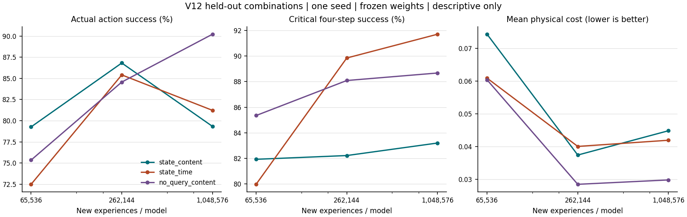

# V12：目录开始影响行为，但完整状态条件没有胜出

日期：2026-10-12。三组预先声明的配置、单个训练种子，全部完成。
不重跑配置，不选择中期最佳检查点，不增加种子追求正结果。

## 结论

这轮得到一个可以继续研究的正结果：检索确实影响实际物理行为。
表现最好的组在冻结权重后，允许读取数据库时成功率为90.21%，
禁用读取时为74.19%，相差16.02个百分点；预测误差和物理代价也改善。
这不是与另一个模型答案的一致性，而是动作实际代价距当前物理最优值
不超过0.02的比例。

但原先更看好的“当前状态查询+内容目录”没有胜出，最终只有79.33%。
胜出的是仅在检索计划中屏蔽当前状态查询、保留年龄/缓存状态/内容提示的组。
预测器和组选取器仍然看到当前身体状态，不能说整个模型无需状态。
这是一次有信息价值的反预期结果，不是已获得通用有效算法或全局最优。

## 实验边界

- 总参数126,918，四个独立预测组；每次预测执行其中一个30,985参数的组。
- 三组初始化、外部世界种子、参数和训练量相同；各自行动会改变后续轨迹。
- 每组64个并行世界，连续学习65,536、262,144、1,048,576次新经历。
  环境、目录、优化器、重放和随机数状态不重置。
- 最终每组另有524,288次目录计划事实重放；不能把这些当作新经历。
- 16条活跃目录、3个原始缓存槽、原始SQLite、153个有限操作候选。
  淡出可以查回，不永久定义某条细节有用或无用。
- 目录摘要只有无符号通道存在信息。数值预测不使用旧目录摘要，
  只使用当前或查回缓存中的原始图像、身体传感器与缓存年龄/掩码。
- 每个预测组学习已执行动作的后果；组选取器学习被选组误差；
  计划评分器学习实际四步结果。三者边界断开梯度。
  模块内部仍有反向传播，这不是完全局部的生物突触学习规则。

环境比V11改变了：风险固定、线索次序随机、变化时身体有可观察扰动。
不能用跨版本分数差直接归因新机制。完整预注册条件见[PROTOCOL.md](PROTOCOL.md)。

## 训练量与未见组合

冻结探测使用训练未出现的两种物理参数组合，不用探测成绩调参。

| 检索计划输入 | 65,536次 | 262,144次 | 1,048,576次 | 最终关键四步 |
| --- | ---: | ---: | ---: | ---: |
| 当前状态+内容 `state_content` | 79.26% | 86.82% | 79.33% | 83.20% |
| 当前状态+时间，无内容 `state_time` | 72.48% | 85.41% | 81.22% | 91.70% |
| 屏蔽状态查询，保留内容 `no_query_content` | 75.35% | 84.56% | 90.21% | 88.67% |

第三组随训练量提高，前两组中期提高后回落。更多经历会产生作用，
但效果取决于学习机制；这组结果不支持“当前问题只是量不够”。
三个取样点不足以证明阶段性涌现，也不能证明局部学习必然提高泛化。
时间对照在关键四步最好，不能把第三组说成所有指标都最好。

## 检索是否真正有用

同一最终权重、相同外部世界种子，分别允许和禁用数据库读取。
禁用读取会让策略选择其他合法操作，也会改变未来身体状态；
这是整个检索策略的干预，不能分解为每条信息的精确因果价值。

| 配置 | 允许读取 | 禁止读取 | 成功率差 | 关键四步差 | MSE差 | 物理代价差 |
| --- | ---: | ---: | ---: | ---: | ---: | ---: |
| 当前状态+内容 | 79.33% | 76.36% | +2.97个百分点 | +3.32个百分点 | -0.002114 | -0.003460 |
| 当前状态+时间 | 81.22% | 77.38% | +3.84个百分点 | +1.95个百分点 | +0.000067 | +0.001155 |
| 屏蔽状态查询，保留内容 | 90.21% | 74.19% | +16.02个百分点 | +7.42个百分点 | -0.011832 | -0.021010 |

差值均为允许读取减去禁止读取。MSE和物理代价越小越好。
第二组成功率提高，但MSE和平均代价略差，必须保留这个分歧。
第三组的MSE由0.025833降到0.014000，物理代价由0.050827降到0.029817。
它的已见组合成功率为89.58%；不同组合难度不同，不能用90.21%高于89.58%
推导未见任务普遍更容易或有更强泛化。

## 目录和参数分工

| 最终未见组合 | 原始读取数 | 本周期线索读取 | 变化时两条线索均在缓存 | 最大预测组份额 |
| --- | ---: | ---: | ---: | ---: |
| 当前状态+内容 | 760 | 338 | 3.75% | 69.84% |
| 当前状态+时间 | 1,241 | 113 | 2.19% | 99.99% |
| 屏蔽状态查询，保留内容 | 2,103 | 1,451 | 0.00% | 39.62% |

“本周期线索”指本周期第0和第4步的原始记录；其他读取可能包含前周期
仍然相关的线索，不按这个统计永久认定细节无用。

第三组最终没有使用成对检索，全部2,103次读取都是单条。
因此本轮没有验证“成对恢复并同时持有两条线索”成功。
两条线索未同时保留仍能获得较好行为，可能与单条线索、身体反馈和参数分工
共同有关；不能从这份观察直接指定唯一原因。
另一个任务限制是：未见集合只有(0,0)和(3,3)，两个物理属性在这个
测试子集中完全相关。虽然这些组合没有进入训练，它仍不足以严格检验
必须同时整合两条独立线索的能力；后续应改变组合设计，不能用本轮
成功率代替双线索组合能力的证明。
第二组几乎只用一个预测组，不能说所有配置都学会了分工。

最终训练段中，keep占比依次只有0.318%、0.245%、0.205%，
最终未见探测三组全部零次keep。候选构成为keep 1种、读取136种、fade 16种；
训练探索在合法候选中均匀抽样，没有平衡三类操作的学习机会。
这提示需要检查操作覆盖与估值偏差，不证明单纯提高keep比例就会更好。
详情见[pilot/OPERATION_COVERAGE.json](pilot/OPERATION_COVERAGE.json)。

## 解释与下一步

本轮支持“目录恢复可以在局部更新下有实际作用”，
不支持“输入越完整越好”“训练越久越好”或“已找到全局最优”。
三组并非完整的二乘二设计，不能独立估计状态与内容的一般交互效应。
只有一个训练种子，64条连续世界轨迹也不能当作百万个独立统计样本。

接下来的优先问题是改动算法，而不是重跑同配置：

1. 将操作类别选择和具体记录选择分开，有限探索预算覆盖各类操作；
   候选空间扩张不能自动稀释keep的机会。具体检索再缩到少量目录候选。
2. 重新设计跨时间的事实归因。四步绝对回报未必能评价二十步后才显现的
   保留价值；应跟踪实际经历和记录身份的后果，允许价值再次翻转。
3. 区分预测器正在变化与检索真正改善结果。计划估值面对一个不断变化的
   预测器，仅回归绝对代价可能混淆二者。比较机制只能使用实际观察，
   不能把模拟器知道的未执行动作最优解偷渡成训练标签。
4. 在目录选择、局部学习和反馈时间尺度明确后，再扩大参数规模。

这些是待验证候选，并非已经证明的改进，也不自动具有论文新颖性。
下一轮应先核对最接近的已有算法，并使用新实验目录；本轮没有启动V13。

## 计算、核验与数据

每组训练估计总乘加173,774,209,024次；计划评分约为数值预测的2.002倍。
虽然每个评分网络小，153候选的总体工作并不廉价。
计数不覆盖SQLite、排序和数据搬运，不能等同实际硬件提速。
三个训练进程阶段累计时间分别676.1、953.7、1312.3秒，
后两组与审计部分并行，时间不同不能归因算法优劣。

六项工程契约通过。独立NumPy物理公式、原始图像重建目录、
缓存生命周期、合法候选和四步反馈审计通过：
24个目录、3,468,288次转移、867,072个操作窗口、924,303次原始读取。
训练前源码哈希与结束后相同。审计的SQLite顺序读取调整保留了旧源码和凭据，
见[ENGINEERING_NOTES.md](ENGINEERING_NOTES.md)。

这仍是小型物理软件仿真，不是果蝇大脑动力学、Qwen分层精度实验、
逐系数稀疏激活或动态创建参数。有限候选估值和局部模块下降都不保证全局最优。

完整汇总见[RESULTS.md](RESULTS.md)和[pilot/SUMMARY.json](pilot/SUMMARY.json)。
完整数据归档标签为 `research-v12-pilot-20261012`；
上传、远端读回校验和清理以根目录 `archives/` 对应凭据为准。
本地只保留最终三个 `resume.pt` 及小文件。
续训前需要从归档恢复对应 `events.sqlite`，不能用空数据库接续。
