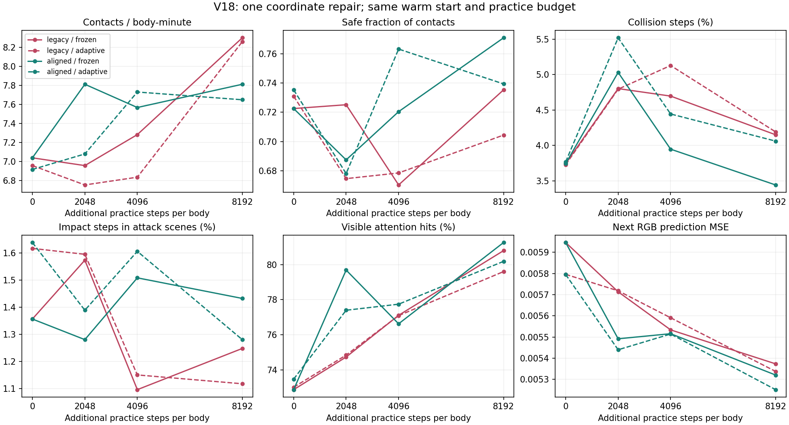
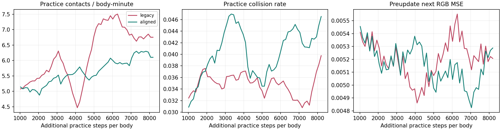

# V18：方位修复正确，但保留调度尚未形成整体优势

2026-10-13。完整两组实验，没有按结果提前停止或更换随机种子。

## 本轮回答

V17的下一帧收益回写错位已经修复。正反旋转、环形接缝、不同身体、连续
旋转、重置与缓存均通过核验；全量原始记录重建的方位公式与实际运行一致。

继续实践带来进步，但**不能把进步归因于方位修复，也不能宣布保留机制胜出**。
修正组最终开发观察中的碰撞更少，旧对照组目标接触更快、受击更少。
整个随机练习过程中，旧对照组也有更高接触率和更低碰撞率。

这轮是实现正确性的修复，不是已经发现更优算法或证明生物式泛化。

## 起点、训练量与边界

- 两组共享V17固定组最终权重，逐张量核对相同。
- 权重热启动；物理世界、优化器、视觉痕迹重新建立，不是原身体精确续训。
- 祖先经历1179648条；每组新增589824条，祖先加新增合计1769472条。
- 每身体新增8192步；72身体并行，72种训练组合池，24种开发观察组合。
- 初始72身体覆盖全部训练组合，之后每个物理段重新随机抽样；
  并非每个时刻都有72种不同组合同时出现。每个身体仍保持自身时间顺序。
- 128格平面360度RGB复眼，105810参数，场景、奖励、网络和学习目标不变。
- 两组分别是legacy旧回写与aligned修正回写，唯一算法变量是收益方位。
- 两个独立CUDA训练进程；物理由Pymunk在CPU调度。
- 自身转动只按最近整数格对齐；没有声称补偿独立物体运动、平移或遮挡。

起点SHA-256：
d29eba87106274183bcad53448923d297b0d6750aa9c82a33bc5592ac04b56ef。

初始效用冻结观察不只是汇总值相同，逐步动作、路由、奖励、锁定和预测
误差也完全相同。允许修订效用的观察从初始阶段起可以有不同轨迹。

## 过程：效用冻结的开发观察

网络权重冻结，效用反馈关闭，但历史和年龄正常随观察更新。
每次24身体、512步，使用相同开发组合与起点种子。

| 新增步/身体 | 旧组接触/分钟 | 修正组接触/分钟 | 旧组碰撞步 | 修正组碰撞步 | 旧组受击步 | 修正组受击步 |
|---:|---:|---:|---:|---:|---:|---:|
| 0 | 7.039 | 7.039 | 3.74% | 3.74% | 1.36% | 1.36% |
| 2048 | 6.958 | 7.812 | 4.80% | 5.03% | 1.57% | 1.28% |
| 4096 | 7.284 | 7.568 | 4.70% | 3.95% | 1.10% | 1.51% |
| 8192 | 8.301 | 7.812 | 4.15% | 3.44% | 1.25% | 1.43% |

受击步的分母是攻击场景步数。它不是每次攻击的躲避成功概率。

修正组接触先增、回落、再恢复；碰撞先恶化、再改善；攻击应对没有同步
改善。旧组后期接触继续提高，但碰撞仍高于起点。没有一个单调的总能力曲线。

## 过程：实际随机练习

这些数据来自真实采样动作和在线更新，不是冻结的贪心策略。它们与上表的
组合池和行动方式不同，不能把两张表的绝对值直接混在一起比较。

| 新增区间 | 旧组接触/分钟 | 修正组接触/分钟 | 旧组碰撞步 | 修正组碰撞步 | 旧组无碰撞接触比例 | 修正组无碰撞接触比例 |
|---|---:|---:|---:|---:|---:|---:|
| 0—2048 | 5.252 | 5.008 | 3.43% | 3.46% | 66.24% | 67.30% |
| 2048—4096 | 5.388 | 5.612 | 3.66% | 4.36% | 71.81% | 63.32% |
| 4096—8192 | 7.000 | 5.948 | 3.46% | 4.13% | 70.43% | 65.99% |

修正组也在持续提高接触速度，但后段不如旧组，碰撞代价更高。
整个练习期接触/分钟为旧组6.160、修正组5.629；碰撞步比例为3.50%、4.02%。
不能只挑最终开发观察中的低碰撞结果，掩盖练习过程中的劣势。

## 最终两种观察

adaptive表示权重冻结、效用继续依据实际下一帧修订。没有梯度更新，
也不把这些观察算入训练量。

| 指标 | 旧组frozen | 修正组frozen | 旧组adaptive | 修正组adaptive |
|---|---:|---:|---:|---:|
| 接触次数 | 204 | 192 | 203 | 188 |
| 无碰撞接触次数 | 150 | 148 | 143 | 139 |
| 无碰撞接触比例 | 73.53% | 77.08% | 70.44% | 73.94% |
| 接触/分钟 | 8.301 | 7.812 | 8.260 | 7.650 |
| 碰撞步 | 4.15% | 3.44% | 4.19% | 4.06% |
| 攻击场景受击步 | 1.25% | 1.43% | 1.12% | 1.28% |
| 可见时注意力命中目标 | 80.80% | 81.26% | 79.60% | 80.19% |
| 下一帧RGB误差 | 0.005373 | 0.005321 | 0.005338 | 0.005252 |

修正组的无碰撞接触比例更高，但无碰撞接触总数并未超过旧组。
允许即时修订效用没有稳定提高接触表现。预测误差略低也没有对应整体行动
优势。这支持继续研究价值信号，而不是把图像预测损失当作唯一学习目标。

## 机制诊断

修正组整个训练期间，各方位绝对预测收益均值0.000223；
约5.38%的方位帧绝对收益大于0.001。正负收益没有先按方位平均再抵消。

门控与同一时刻固定遗忘门控的实际差异：

| 新增区间 | 平均绝对门控变化 | 变化超过0.001 | 变化超过0.01 |
|---|---:|---:|---:|
| 0—2048 | 0.000795 | 23.32% | 0.346% |
| 2048—4096 | 0.000754 | 21.94% | 0.307% |
| 4096—8192 | 0.000747 | 21.38% | 0.347% |

这说明门控变化平均偏弱，不说明细节没有价值。少数较大变化仍存在，
其价值应由后续反复实践修订，不能永久给某类细节判定“无用”。

同一实际轨迹上，按另一种方位规则重建的影子门控，与实际门控平均绝对
差异约0.00075—0.00079。该诊断只重算记账，不重新运行影子策略或预测器，
因此不是方位修正对行为的独立因果估计。

当前收益来自“保留慢历史”和“整片清空慢历史”的RGB预测误差差值，
上一帧仍保留；卷积会把邻域联系在一起。这既不是全部时间信息的价值，
也不是每个扇区的独立因果贡献。门控变化偏弱只是下一轮需要检验的候选
限制，不能据此宣称找到了行为差异的唯一原因。

## 核验、解释范围与保存

- 21项接口检查通过，旧组Session与V17旧实现的小样本动作及更新逐张量相同。
- 18个完整会话，1376256条原始转移，全量行为统计独立重算通过。
- 73728个SHA-256摘要核对效用读取前、反馈后与实际门控；
  每个摘要覆盖该时刻全部身体、全部方位，没有抽样挑选。
- 训练源码摘要与快照一致；两个模型起点逐张量相同。
- 没有新增模拟器最佳行动标签或策略输入中的目标坐标。
- 只有一组初始化及两条学习轨迹；相同世界种子不能保证行动分叉后
  仍有相同随机事件。没有统计显著性、普遍优越性或长期泛化证明。
- 开发组合已在历轮用于观察；不是新的确认性测试集。
- 注意力命中目标仍不是身份保持证明；平面复眼仿真仍不等于真实脑动力学。

完整数据归档标签：research-v18-frame-repair-20261013。
上传、远端SHA-256核验及清理状态以STATUS.md和archives目录收据为准。
保留两组最终工作权重；数据库原始经验从完整归档可恢复，不因遗忘门控
而删除具体事实。下一轮问题见NEXT_V19_ZH.md。
