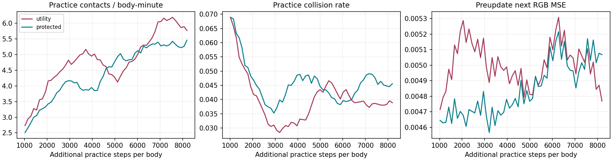
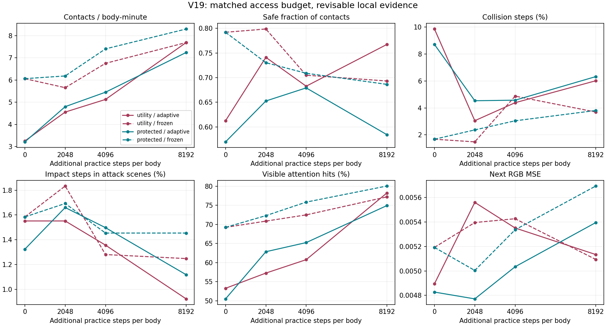

# V19：可逆记忆访问与分歧保护实验

2026-10-14。训练前协议见 `PROTOCOL_ZH.md`，完整结果见
`local_memory/ANALYSIS.json`。两臂完成预先登记的全部预算，没有重跑或挑选种子。

## 结论

持续实践后，两组的触达和安全触达速率均高于实践前期，但给记忆价值增加
“预测成员分歧保护”没有取得整体优势。保护组早中期付出的行为代价较大，
后期安全触达速率追近；最终开启记忆评分的开发观察仍弱于纯收益组。
这是一次保留失败的开发结果，不足以判定该类机制普遍无效。

用户提出的“遗忘、重复学习、预测或测试构成持续筛选与分层机”仍是研究假设。
本轮验证了信息可以被少访问、重新考察和再次选中；尚未验证
“因遗忘而失误、主动检索、重新学习、行为恢复”的完整闭环，更未证明抽象层级形成。
重要性需要在经历中修订，不能将某类细节永久判作无用。

## 实际做了什么

沿用 V17 物理世界、奖励、四个局部策略专家和 128 眼平面 360 度 RGB。
模型只得到视觉和自身状态，不得到物体坐标、物体身份或最佳动作标签。
各模块独立优化、跨模块输入断梯度；这是计算机上的离散模拟，不是生物脑动力学复原。

新增三个下一帧预测器，通过固定自举子样本学习。每步省略一个 16 眼慢历史输入块，
比较同一事实动作下完整与省略输入的局部预测误差，形成相对收益。
收益写回被干预的当前输入块；下一次读取才按自身旋转修正记忆方位。
预测考察使用未遮掉的慢痕迹，让暂未访问的细节仍有重新被评估的机会。

两臂每步都只访问 64/128 眼慢历史：56 眼按评分、8 眼随机复查。
当前与前一帧完整可用；没有删除底层慢痕迹，也没有实现数据库主动检索回放。

| 两臂唯一比较项 | 访问优先级 |
| --- | --- |
| 纯收益 `utility` | 局部相对预测收益的移动平均 |
| 分歧保护 `protected` | 上述平均值 + 三个成员收益标准差的移动平均 |

成员分歧不是已校准的认知不确定性；预测残差也不是已识别的偶然噪声。
输入省略包含慢历史及门控、年龄元信息，不能将收益解释为纯 RGB 细节的独立价值。

## 规模与训练量

两臂均为 124,696 参数，共同继承 V18 aligned 权重，使用新的优化器、身体世界和痕迹。
72 个身体并行实践，初始覆盖 72 种训练组合，后续重置重新抽样组合。

| 经历口径 | 条数 |
| --- | ---: |
| 继承权重的祖先训练经历 | 1,769,472 |
| 共同校准训练，72 x 1024 步 | 73,728 |
| 每臂新增训练，72 x 8192 步 | 589,824 |
| 本轮独有训练经历，校准只计一次 | 1,253,376 |
| 每个后代连同祖先的累计经历 | 2,433,024 |
| 连同全部开发观察的原始记录 | 1,449,984 |

每身体本轮分臂后仅新增 16.384 分钟仿真实践。每臂采集 64 段 rollout，
登记了 2,304 次小批更新，策略样本呈现 1,769,472 次；重复呈现不是新经历。
不能把百万条相邻转移当成百万个独立实验，或据此断言训练量充分。
共同误差归一化下限为 `0.0005934063228778541`，校准后固定。

## 学习过程

以下是实际练习期的行为，不是与原模型答案的一致性。最后阶段长度为前两阶段的
两倍，因此比较每身体分钟速率。安全触达要求本次触达未受击，并且自上次
触达或重置以来没有碰撞；它不是全程无伤生存率。

| 实践阶段 | 纯收益触达/分钟 | 保护触达/分钟 | 纯收益安全触达/分钟 | 保护安全触达/分钟 | 纯收益碰撞步 | 保护碰撞步 |
| --- | ---: | ---: | ---: | ---: | ---: | ---: |
| 0-2048 | 3.445 | 2.967 | 1.909 | 1.607 | 5.53% | 5.78% |
| 2048-4096 | 4.852 | 4.005 | 3.442 | 2.496 | 3.12% | 4.29% |
| 4096-8192 | 5.325 | 5.188 | 3.481 | 3.465 | 4.05% | 4.43% |

保护组后期追近，并非持续恶化。两组碰撞率也不是单调改善。
练习场景暴露随轨迹而变化，阶段进步是过程描述，不是遗忘机制的独立因果效应。

| 全部实际练习 | 纯收益 | 分歧保护 |
| --- | ---: | ---: |
| 触达次数 | 5,588 | 5,116 |
| 安全触达次数 | 3,631 | 3,254 |
| 触达/身体分钟 | 4.737 | 4.337 |
| 碰撞步比例 | 4.190% | 4.737% |
| 攻击场景受击步比例 | 1.622% | 1.615% |
| 可见时注意力命中 | 51.87% | 53.11% |
| 下一帧 RGB MSE | 0.004972 | 0.004835 |

保护组累计 RGB 误差较低，却没有得到更好的主要行为结果。两组观察轨迹已经不同，
这个误差差异不能解释为对同一批难样本学得更好；更不能用它替代行动质量。

## 阶段观察与初始代价

每阶段在相同 24 个开发组合观察 512 步/身体，权重冻结。
`adaptive` 允许按实际下一帧更新记忆评分；`frozen` 从零评分开始且不更新，
因而实际上是随机预算访问，不是固定住训练结束时的记忆目录。

刚完成共同校准时，随机预算访问的两组轨迹完全一致：6.063 次触达/分钟，
碰撞 1.68%。开启评分后分别变成 3.255/3.215 次触达、9.86%/8.71% 碰撞。
新门控初始扰动了继承策略，这个接入代价不能被最终成绩掩盖。

| 最终观察 | 纯收益，评分开启 | 保护，评分开启 | 纯收益，评分冻结 | 保护，评分冻结 |
| --- | ---: | ---: | ---: | ---: |
| 触达次数 | 189 | 178 | 189 | 204 |
| 安全触达次数 | 145 | 104 | 131 | 140 |
| 触达/身体分钟 | 7.690 | 7.243 | 7.690 | 8.301 |
| 碰撞步比例 | 6.014% | 6.323% | 3.695% | 3.809% |
| 攻击场景受击步比例 | 0.922% | 1.118% | 1.248% | 1.454% |
| 可见时注意力命中 | 78.23% | 74.93% | 77.22% | 80.06% |

最终评分开启时，保护组在 24 个组合中的安全触达为 3 个更高、9 个持平、
12 个更低；逐组合明细保留在 JSON。冻结评分的触达优势不能证明在线保护规则有效。
纯收益组开启评分后安全触达增加，但碰撞也增加，同样没有全面获胜。
注意力命中并不等于保持目标身份，更不等于已经学会主动躲避突发攻击。

## 筛选闭环的证据到哪一步

练习中，每阶段约 29%-33% 的局部考察同时满足“被考察块原先不足一半被访问”
和“这次相对预测收益为正”。对被考察块内原本未访问的眼位，排除身体重置、
并修正下一次旋转之后，正收益对应的下一步再访问比例约 23.8%-26.4%，
非正收益约 11.1%-11.2%。

这表明访问机会可修订，不是永久封存；但评分规则本就利用收益，这不是独立有效性
证明。它没有证明某条语义细节被重新学会，也没有证明再次访问造成行为恢复。
当前目录仍是随自身方位旋转的慢历史格，不具备稳定物体身份和跨场景事件检索。

“天然筛选”仍取决于经历覆盖和实际后果：高频背景可能持续强化，罕见危险也可能
被漏掉。下一轮应记录同一可追踪记忆在失误、检索、重学与再遇中的连续轨迹，
并检验跨场景作用及保持时间，不能仅凭门值不同就称为层级。

## 文献边界

- HSAM 研究不支持直接断言“超级记忆症导致泛化抽象能力薄弱”；已有比较并非
  遗忘机制的因果实验。核对内容见 `MEMORY_RESEARCH_ZH.md`。
- Anthropic 2026-10-12 原始文章中，9B 推理部署、简化复制任务和跨代笔记
  是不同实验。失败笔记继承不等于模型权重自主进化；本项目只借鉴保留失败记录、
  重置短期尝试和有界探索，不实施网络复制。见 `ANTHROPIC_RESEARCH_ZH.md`。
- 重复支持与衰减可以产生保留差异，但现有线性/统计理论不能直接证明非线性具身
  层级。检索晚于本轮启动的补充理论见 `SUPPLEMENT_REINFORCEMENT_ZH.md`，
  没有用于追溯更改本轮标准；未复现他人的论文实验。

## 核验与可恢复性

23 项局部及会话契约测试通过。独立全记录审计核对 19 个会话、1,449,984 条记录、
153,600 个状态摘要，包括 RGB/自身状态连续性、方位、完整慢痕迹、访问位图、
自举身份、收益代数、原始行为统计、共同起点及登记源代码哈希。

另从保存权重重新前向抽查 92 条预测，重建 32,844 条历史记录。局部误差最大偏差
`1.863e-9`，收益最大偏差 `1.253e-7`，在登记容差内。
抽样预测核验不等于逐步重算全部神经输出；全记录审计也不证明算法有效。

只有一个共同起点、每臂一个训练后代；开发场景已经被前期研究查看，没有独立
确认集或实机结果。V19 两组共同改变了 V18 的多个接口，不能用跨版本成绩给
新机制单独归功。阶段权重不含完整物理世界与记忆状态，不能精确断点续训。

完整快照使用标签：`research-v19-local-memory-20261014`。
归档范围包括源码、协议、报告、原始 SQLite/轨迹/视觉、证据及各阶段权重。
发布进度、远端完整读回校验及清理凭据见 `STATUS.md` 和根目录 `archives`；
归档内状态反映打包时刻，发布后的状态以主分支为准。
下一轮候选方案见 `NEXT_V20_ZH.md`，本轮不再追加训练。
