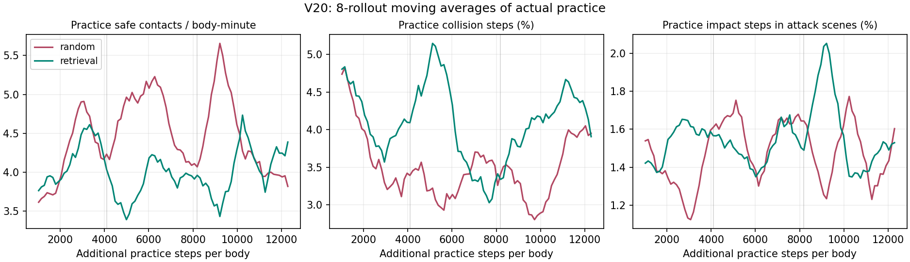
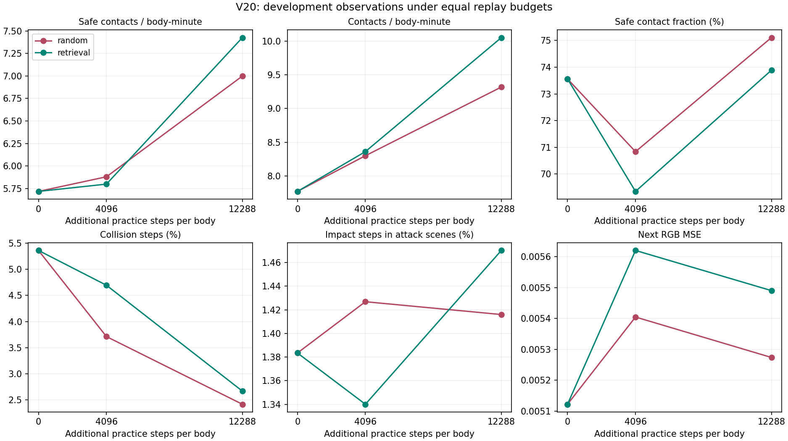

# V20：最后触达更多，学习过程仍吃亏

2026-10-14 开始，2026-10-15 完成核验。完整运行，没有重跑或更换种子挑结果。

**结论：最终观察出现了实际行为收益，但行动后果检索没有整体胜过随机复查。**
检索组最后安全触达 365 次，随机组 344 次，原 V19 策略 292 次。
但检索组练习全程安全触达少 709 次、碰撞更多，失败后 32 步内首次触达比例较低。
这不是答案一致性或预测损失，而是物理环境中真实发生的行为。

## 这轮直接改了什么

- 保持 128 眼平面 360 度 RGB、72 个并行身体和同时多场景实践。
- 从 V19 utility 权重出发，增加独立行动后果模块，参数从 124,696 增至 143,238。
- 对实际执行动作学习未来最多 8 步的进展、触达、安全触达、碰撞、受击。
- 以有限幅度后果预测引导动作；每 128 步检索 1,536 条成熟历史再学习。
- 检索组失败后查视觉/历史/身体状态相似的经历，至少四分之一随机复查；
  对照组同身体、同条数随机复查。两组都保留后果学习和相同策略训练机制。
- 正效用回放额外模仿实际执行动作；负效用回放只训练后果模块，不直接纠正策略。

这是模块局部更新的软件模型，不声称复现生物脑动力学。
后果窗口只记录当前行为轨迹下的事实，不给未执行动作编造反事实标签。

## 最终实际行为

同一批 24 个开发组合，每次 1,024 步，权重冻结，访问状态仍随事实变化。

| 策略 | 安全触达 / 总触达 | 安全触达 / 身体分钟 | 碰撞步 | 攻击场景受击步 |
|---|---:|---:|---:|---:|
| 原 V19 策略，关闭新引导 | 292 / 413 | 5.941 | 5.359% | 1.286% |
| V20 共同起点 | 281 / 382 | 5.717 | 5.363% | 1.383% |
| 随机复查，最后 | 344 / 458 | 6.999 | 2.413% | 1.416% |
| 相似检索，最后 | 365 / 494 | 7.426 | 2.665% | 1.470% |

检索组相对随机组多 6.10% 安全触达，但碰撞多 0.252 个百分点、
攻击受击多 0.054 个百分点。安全触达占全部触达的比例反而较低：
73.89% 对 75.11%。它更常触达，不代表每次触达更安全。
24 个开发组合中安全触达有 11 个增加、12 个减少、1 个持平，不是普遍改善。

相对原策略，两组最后安全触达分别多 17.81% 和 25.00%，碰撞明显减少；
受击都增加。由于没有原 V19 继续同量训练且关闭新机制的第三组，
不能把相对祖先的全部改善归功于后果检索算法。

## 学习过程中发生了什么

每段均为 4,096 步 / 身体，以下是实际训练实践，不是冻结观察。

| 组别 | 第一段安全触达 | 第二段 | 第三段 | 全程 |
|---|---:|---:|---:|---:|
| 随机复查 | 2,466 | 2,728 | 2,609 | 7,803 |
| 相似检索 | 2,400 | 2,291 | 2,403 | 7,094 |

检索组安全触达速率为 4.069 → 3.884 → 4.074 次 / 身体分钟，
没有形成连续进步，三段都落后于随机组。
全程碰撞 4.103% 对 3.564%，攻击场景受击 1.547% 对 1.488%。
不能用最后一张观察表覆盖整个学习过程的代价。

失败后同一目标的 32 步首次触达：
碰撞后检索 25.67%、随机 26.87%；受击后检索 28.64%、随机 30.66%。
分母在失败发生时按完整未来场景预算预选，短窗口成功和失败均单列。
这些只是后续事实，不足以证明检索导致恢复。

## 训练量与检查

每组新增 884,736 条身体事实，共享后果头预热 73,728 条；
本轮独有训练事实合计 1,843,200 条。每组祖先加本轮事实为 3,391,488 条。
每组 PPO 呈现 1,769,472 次，额外回放 147,456 次，96 个查询各 1,536 条。
回放不是新增环境经历。

正效用策略模仿为随机 74,744 次、检索 56,016 次；
两组事实数和回放条数相同，不代表正向策略更新量相同。
检索组模仿较少是下一轮要处理的机制线索，不是已确定的失败根因。

10 个会话、2,015,232 条完整事实后果标签重建通过，最大差值为 0。
历史检索无提前使用后果标签或无效引用；两组末尾待标注均为 0。
15 个冻结源文件哈希匹配。29 项目录与学习契约检查通过。
分析短窗口修正另经合成数组核对，分析源哈希单独保存，未改训练清单。

## 暂不成立的部分

访问权重仍是时间衰减加固定访问提升，没有由之后的行为改善决定。
低权重事件一直可以访问，不能说已证明“遗忘后重新打开”。
每身体目录是 512 条 FIFO；原件在 SQLite，但淘汰记录不会从冷库重新加载。
因此本轮没有完成“遗忘造成失误、查回旧事实、重学后恢复”的因果链。

没有证明独立泛化、抽象层级或稳定视觉物体身份。
24 个组合已反复用于开发；一组初始化、每臂一条实践轨迹。
不把现成的 PPO、近邻检索和回放本身作为新算法成果。

## 下一轮直接改机制

不重复 V20，不先靠调检索门槛或无限加训练量寻找漂亮终值。
下一候选是**可撤销的记忆行动修正**：

1. 成熟失败记忆直接压低相似身体状态下已执行危险动作的概率；
   替代动作必须通过真实尝试产生，之后的事实才能决定保留还是撤销修正。
2. 每次选定记忆后，随机启用其修正或只作影子记录；
   用后来真实安全触达、碰撞和受击差更新记忆的作用价值，不再“访问即加分”。
3. 活跃目录可从数据库调回旧记忆；保持随机复查和衰减，不永久禁用动作或细节。
4. 记录记忆 ID、启用状态、动作、成熟后果、价值修改，直接看重复失败能否减少。

这是下一轮候选，尚未实现或训练。视觉相似不等于动力状态相同，
短期避险也可能妨碍触达；两者都是需要允许推翻该方案的失败点。
不因一个终点优势将检索组升为默认，也不据此否定所有检索机制。

完整数字、逐场景差值与范围说明见
[阶段报告](consequence_relearning/REPORT_V20_ZH.md)、
[分析](consequence_relearning/ANALYSIS.json)、
[审计](consequence_relearning/AUDIT.json)、
[分析来源](consequence_relearning/ANALYSIS_MANIFEST.json)。
完整原件按 `research-v20-consequence-relearning-20261014` 归档；
发布与清理凭据以 [STATUS.md](STATUS.md) 和 `archives/` 收据为准。
