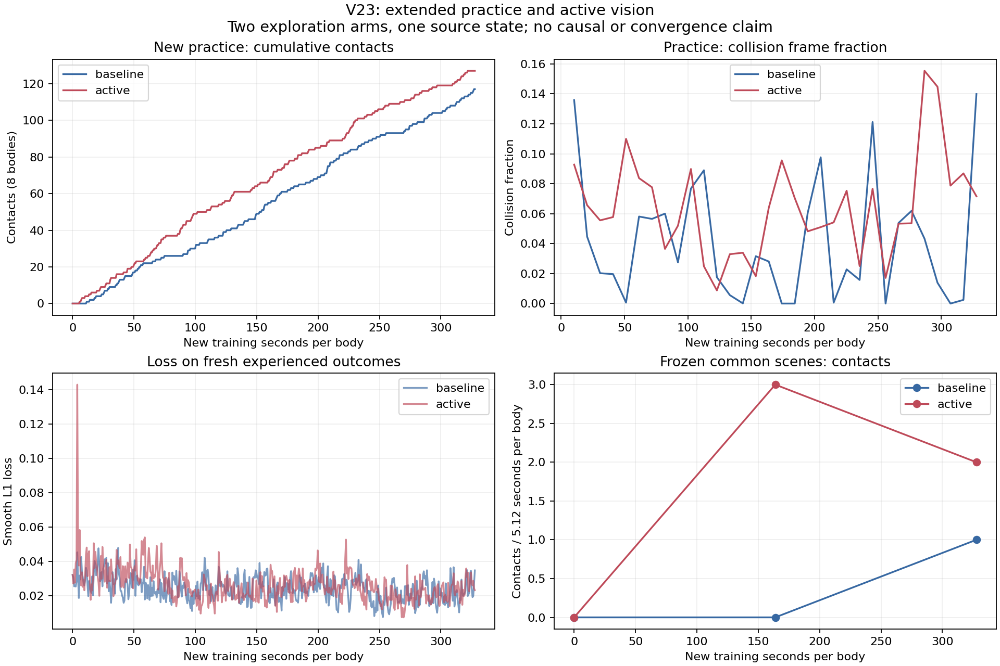
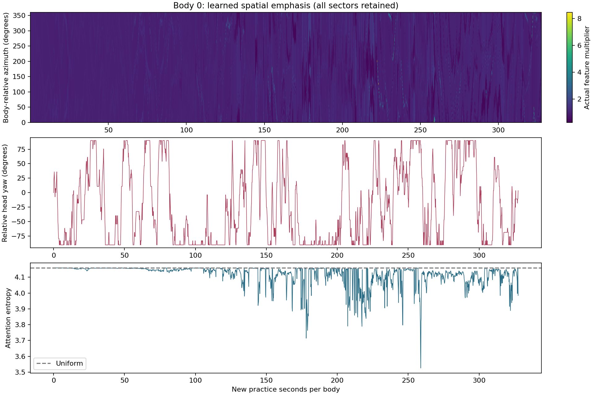

# V23：加量实践、可学习注意力与独立转头

日期：2026-10-17。运行：`results/extended_practice_20261017`。

两臂各新增 32768 步实践、全部冻结观察和机制干预已完成，
学习记录与原始状态核验通过。发布与清理进度见 [STATUS.md](STATUS.md)。

## 实践量与连续性

两组从同一个完整 V22 状态分叉，包含世界、随机状态、优化器、
记忆、未成熟后果窗口和学习安排，不只是加载最终权重。
基线延续原机制；主动视觉组增加局部细节、可学习空间注意力和独立头动作。

每组 8 个同时实践的身体，每身体新增 32768 个 10ms 步，
即 327.68 秒。每组共 262144 张新感官帧、65536 次新动作选择。
另有每身体 64 步兑现最后的学习信用，不混入上述训练量。
新增实践是 V22 上轮的 4 倍，但加历史后每身体仍不到 7 分钟。
更多实践、更多参数更新和更多有效学习是三件不同的事。

原生视觉仍为 1024×512、360°全景、100Hz，物理积分 1ms，
LIF 脉冲阈值网格 0.1ms。身体共享参数，各自保持动态状态。
这是计算机上的分步数值计算，环境为 2.5D，不是生物脑或果蝇身体的 1:1 仿真。

## 这次增加了什么

- 将 9 种身体动作扩展为 27 种身体与头部联合动作。
  头可保持、向左、向右，范围 ±90°，速度 π rad/s，按 1ms 积分。
- 保留整个全景；头部方向改变原生图像的局部细节裁剪方向。
  全局特征回到身体坐标，不把转头误当作身体旋转。
- 64 个方位扇区的注意力由视觉、身体和内部状态共同计算，
  进入实际可训练的预测通路。特征倍率为
  `0.25 + 0.75 × 64 × softmax(score)`，外围通道保留最低贡献。
- 主动视觉输入为 964 维，基线为 576 维。
  局部原生裁剪为 256×256，再汇聚成 3×8×16 个特征；
  原生像素数不等于最终表示的分辨能力。
- 预测器参数数分别为 101954 和 184942，另有连续状态和脉冲机制。
  这轮同时改变表示、动作和参数量，不能单独归因于某一模块。

头动作没有人工目标朝向提示；身体追踪、避障反射和需求权重仍含人工设计。
输入没有目标真实坐标或标准动作答案。
继续保留短期负收益更新，通过之后的真实经历调整学习安排、记忆价值和学习率。
功能性连续内部状态不等于意识，也还不是完整自主价值体系。

## 如何观察过程

实践按四个等长 8192 步区间统计，不只看终点。
新增 0、16384、32768 步时，冻结参数，在相同的 8 个场景各观察 512 步。
最终另用独立场景观察 1024 步，并分别固定头部或强制均匀注意力。
这些冻结观察不训练，也不用于选择更新。

另加一项冻结权重、保留训练期探索动作的最终观察。
它是在看到基线中点结果后追加的诊断，不能替代预定的贪心观察。
不同动作会造成不同后续轨迹，干预结果也不能完全分离训练贡献。

物理接触、安全接触、碰撞、受击以及持续学习过程是主要观察对象。
注意力熵下降、参数变化、转头次数或局部预测损失下降，都不单独算成功。
头角和速度在新指令执行前采样，发出转头指令也不等于头实际转动。
同场景的少量事件和单个训练种子，不能证明稳定泛化。

## 加量实践的实际结果

下表仅统计新增训练，不含历史和最后的 64 步兑现。
受击统计独立事件数，碰撞统计发生碰撞的感官帧比例。

| 机制 | 目标接触 | 安全接触 | 碰撞帧比例 | 受击事件 | 死亡 | 新预测器更新 |
|---|---:|---:|---:|---:|---:|---:|
| 延续基线 | 117 | 95 | 4.0810% | 566 | 72 | 1415 |
| 主动视觉 | 127 | 96 | 6.4445% | 548 | 71 | 1173 |

主动组接触更多、受击略少，但安全接触几乎相同，碰撞更多，
不能称为整体胜出。两组经历不同，不把过程累计数当作固定题库正确率。

| 新增实践区间 | 基线接触／安全 | 主动接触／安全 | 基线受击 | 主动受击 |
|---|---:|---:|---:|---:|
| 0–8192 | 26／20 | 37／28 | 139 | 141 |
| 8192–16384 | 30／23 | 35／25 | 137 | 141 |
| 16384–24576 | 34／32 | 32／25 | 135 | 129 |
| 24576–32768 | 27／20 | 23／18 | 155 | 137 |

主动组接触在四段中逐渐减少；基线也不是单调进步。
更多实践并未自动变成持续更优选择，不能用预测损失下降替代这个缺口。

两臂训练加兑现后分别共 1774、1532 次预测器更新，其中 V22 历史都是
359 次。新增兑现后的学习安排共 512 次：基线暂停／新经历／召回为
65／373／74，主动组为 140／315／57。主动组暂停更多，新增更新更少。
其学习安排依据未来预测收益和成本，尚未直接衡量长期行动改善；
不能因此认定暂停一定正确，也不能直接把暂停判错。
新增负收益学习尝试分别为 102、106 次，均未回滚。

## 固定场景中的阶段变化

每次冻结观察为 512 步／身体，场景初始种子相同；没有参数更新。
两臂起点的全部物理指标一致。

| 机制／新增训练步 | 接触／安全 | 碰撞帧比例 | 受击事件 | 目标接近量 |
|---|---:|---:|---:|---:|
| 共同起点 0 | 0／0 | 11.4990% | 3 | −0.362 |
| 基线 16384 | 0／0 | 7.0801% | 3 | −2.459 |
| 基线 32768 | 1／1 | 9.7900% | 3 | 7.444 |
| 主动 16384 | 3／3 | 4.3213% | 3 | 9.009 |
| 主动 32768 | 2／2 | 10.4736% | 2 | 10.968 |

目标接近量是各步目标距离缩短量的累计，允许负数；不是成功率。
主动组中点接触和碰撞较好，末点部分回落，因此不能只选中点报喜。
主动组末点的两次安全接触来自身体 0、2，碰撞主要集中在身体 3、7；
八个身体并没有一起形成稳定改善。

## 注意力和头部确实发生了什么

完整新增训练期间共记录 65536 个动作决策，以下不含最后的兑现步骤。
这里的注意力是空间扇区加权，头是虚拟传感器关节，不是 LLM 的注意力头。

| 新增实践区间 | 注意力熵均值 | 最强扇区平均特征倍率 | 动作前采样正在运动 | 头部处于限位 | 限位处向外转指令 |
|---|---:|---:|---:|---:|---:|
| 0–8192 | 4.154664 | 1.191 | 40.52% | 35.58% | 19.28% |
| 8192–16384 | 4.138183 | 1.518 | 36.15% | 53.10% | 34.48% |
| 16384–24576 | 4.102519 | 1.953 | 41.06% | 44.17% | 25.61% |
| 24576–32768 | 4.103896 | 1.936 | 40.97% | 43.68% | 28.43% |

均匀注意力熵为 4.158883。注意力从接近均匀逐渐产生差异，但后两段并未
继续单调集中；最后一段个别最强倍率达到约 17，不代表平时都有这么强。
表中运动比例是动作选择前的速度采样，不是按指令数推算的运动量。
限位处发出外转指令不会产生相应转动；也不能预先把固定注视判定为错误。
逐身体统计包含全部 8 个身体，图只展示身体 0 的一条过程。
按全部新物理帧统计，实际头部运动占 39.72%，总行程为 3271.50 弧度
（八个身体合计）。这证明传感器方向发生了变化，不证明它转得有用。

## 独立场景与机制干预

以下都从同一最终模型重置动态状态，每个身体观察 1024 步，使用相同的
八个独立场景初始种子。基线用自己的最终模型。所有观察参数冻结。

| 条件 | 接触／安全 | 碰撞帧比例 | 受击事件 | 目标接近量 |
|---|---:|---:|---:|---:|
| 基线正常 | 3／2 | 1.8677% | 14 | 14.323 |
| 主动视觉正常 | 3／1 | 2.6367% | 17 | 12.039 |
| 主动视觉强制均匀注意力 | 3／3 | 0.0000% | 17 | 10.789 |
| 主动视觉固定头部 | 3／1 | 2.6123% | 15 | 12.485 |

强制均匀注意力后安全接触更多、碰撞更少，正常头部运动也未带来已观察到的
行为优势。这组诊断不支持“注意力学会变化、会转头，因此就更会观察”。
事件很少，干预后轨迹会分叉，不能反过来证明注意力或转头一般无用。
本轮没有初始模型在这组独立种子上的结果，不能用最终 3 次接触声称进步。

主动组独立场景输入干预中，改变视觉／内部状态后，注意力元素均值 L1 变化为
0.003360／0.001241；强制均匀注意力／清零细节后，预测输出元素均值 L1
变化为 0.017927／0.262114。这些说明通路实际依赖输入，
不是 64 扇区的总 L1，也不是行为收益或泛化得分。

保留训练期探索动作的额外冻结观察也已完成，每身体 1024 步，
使用上述独立场景。两臂预测器、状态、脉冲和学习安排参数均未更新。

| 条件 | 接触／安全 | 碰撞帧比例 | 受击事件 | 目标接近量 |
|---|---:|---:|---:|---:|
| 基线保留探索 | 4／4 | 1.4038% | 12 | 14.590 |
| 主动视觉保留探索 | 3／1 | 2.0264% | 10 | 11.537 |

这个追加诊断没有扭转上述判断。主动组受击较少，但安全接触和碰撞仍落后；
不能把探索动作与贪心动作的差异当作新的训练收益。

## 量与机制如何判断

这轮不能把问题归结为“量够了，机制错了”，也不能继续用“量不够”
解释所有回落。新增量达到上一轮四倍后，出现了注意力分化、实际转头和
阶段性行为改善，但没有形成稳定更优选择。累计每身体仍不到七分钟，
八个训练组合也不等于充分场景覆盖。

下一机制候选是不同时间尺度的观察信用：将当下转头与随后获得的信息、
再之后的安全行动和持续学习后果联系起来，同时观察是否减少无效重复。
当前物理预测窗口主要为 0.32 秒，学习安排信用主要来自随后 0.64 秒的
局部预测收益，可能不足以计量较晚的观察作用；这是待验证解释。
后续需要同时保留长时间同机制续接和新机制分支，分别记录新经历、更新、
场景覆盖与过程变化。机制调整进入新版本，不修改本轮运行源码或抹去失败。
已有调研及其局限见 `ACTIVE_VISION_RESEARCH_ZH.md`。

## 记录核验

两臂合计核验 657408 帧物理记录、656912 个后果窗口，以及 1280 次已兑现
学习选择，包含相同的历史前缀，不能全部算成新增样本。
输入宽度、动作范围、物理标签、更新保留、学习率变化和运行状态校验通过；
两臂末步均为 41088，没有未兑现的学习选择，预测器参数有限且数据库未被审计修改。
核验是记录完整性证据，不是行为有效性证据。

两臂清单中的 14 个运行源码哈希均匹配。V22 源数据库仍为 SHA-256
`9f6b104c938d15907c154fed2150e39055f7d3f722df0cb1ccf1f261f4e67ce7`。
详见本轮 `completion_audit.json` 和 `provenance_check.json`。

## 文件与恢复

- `results/extended_practice_20261017/`：主训练、汇总与图；完整观察数据库见归档。
- `PLAN.md`、`IMPLEMENTATION.md`：预定设计、迁移和恢复语义。
- `ACTIVE_VISION_RESEARCH_ZH.md`：已调研工作及下一轮候选。

完整快照已上传，15 个分片已从远端完整读回核验；随后清理了 12 个
观察数据库和上传暂存，合计释放约 2.19 GB，包含临时重复副本。
两臂主训练数据库、全部 12 份阶段／最终权重和 V22 续接工作集保留。
完整归档标签为 `research-v23-extended-practice-20261017`；
快照发布后的核验与清理收据见 `STATUS.md` 和仓库 `archives/` 对应目录。
